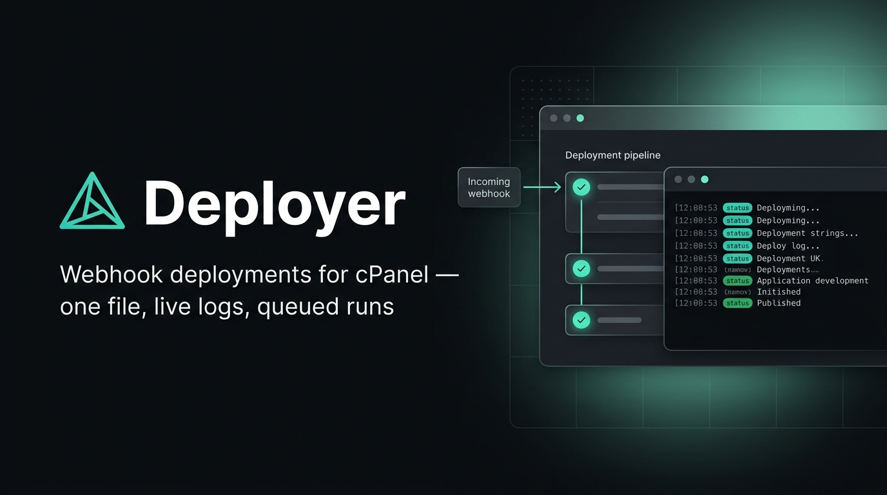

<p align="center"></p>

# Deployer

Deployer is a self-hosted deploy runner for shared hosting. It ships as **one file** (`deployer.phar`, uploaded as `index.php`) and needs no daemon. You get a web dashboard where you run YAML-defined deploy steps from a webhook or a button, watch the logs live, cancel runs, and get a Telegram message when a run ends. It works under Apache + PHP-FPM (cPanel); runs are executed by a detached PHP CLI process, not by the web request.

- **Single-file artifact**: upload one phar, optionally one `.htaccess`. No terminal needed to install.
- **Per-project queue, parallel projects**: runs of the same project queue up; different projects run side by side.
- **YAML pipelines**: one `deployer.yml` per project folder, with `vars`, real `env` variables and multi-command `run` lists.
- **Strict failure detection**: the first failing command fails the step, pipes included (GitHub Actions semantics).
- **Live logs and focused step view**: follow the whole run, or click a step to see only its command, output and result. Commands are highlighted as bash, and **Copy** puts the visible log on the clipboard.
- **Cancel and retry**: cancel stops the whole process tree (SIGTERM, then SIGKILL); a failed or cancelled run can be retried in one click.
- **Webhooks with a token**: trigger from GitHub Actions, GitLab, Gitea or plain `curl`; revoke the token at any time.
- **Telegram notifications**: groups, channels and forum topics.
- **Self-update** from GitHub Releases, from the dashboard, the CLI or cron.

## Contents

- [Quick start (cPanel)](#quick-start-cpanel)
- [Requirements](#requirements)
- [Configuration](#configuration)
- [Pipeline YAML](#pipeline-yaml)
- [Webhooks](#webhooks)
- [Telegram notifications](#telegram-notifications)
- [Updates](#updates)
- [URLs: with or without `.htaccess`](#urls-with-or-without-htaccess)
- [CLI and password recovery](#cli-and-password-recovery)
- [Troubleshooting](#troubleshooting)
- [Security notes](#security-notes)
- [Known limitations](#known-limitations)
- [Development](#development)
- [Changelog highlights](#changelog-highlights)

## Quick start (cPanel)

Everything below can be done with the cPanel **File Manager** and **Cron Jobs** pages; no terminal is required.

1. **Create a subdomain**, e.g. `deploy.example.com` (docroot `~/deploy.example.com`).
2. **Download** `deployer.phar` and `deployer.htaccess` from the [latest release](https://github.com/yebt/php-cpnl-webhook-deployer/releases/latest).
3. **Upload** them into the docroot and rename them:
   - `deployer.phar` → `index.php`
   - `deployer.htaccess` → `.htaccess` (optional: clean URLs, see [URLs](#urls-with-or-without-htaccess))
4. **Create `deployer.config.php`** next to `index.php`:

   ```php
   <?php
   return [
       'data_dir' => '/home/USER/deployer-data',   // outside the docroot
       'php_cli'  => '/usr/local/bin/php',         // or /opt/cpanel/ea-php84/root/usr/bin/php
   ];
   ```

5. **Add the recovery cron** (cPanel → Cron Jobs, every minute):

   ```cron
   * * * * * /usr/local/bin/php /home/USER/deploy.example.com/index.php runner:sweep >/dev/null 2>&1
   ```

6. **Open** `https://deploy.example.com/` (or `/index.php/` without `.htaccess`) and **create the admin account** right away: the first visitor of a fresh install becomes the only admin.
7. **Create a project**, write its pipeline, press **Deploy**.

To verify the download first: `sha256sum -c deployer.phar.sha256` next to the downloaded `deployer.phar`. Later versions install themselves (see [Updates](#updates)).

## Requirements

| Need | Why | Check |
|------|-----|-------|
| PHP ≥ 8.2 (web and CLI) | runtime | `php -v` |
| `proc_open` enabled | starts the runner and the steps | `check.php` below |
| `phar` extension | the artifact is a phar | `php -m \| grep -i phar` |
| `pdo_sqlite` extension | storage (one SQLite file) | `php -m \| grep -i sqlite` |
| `curl` extension | Telegram notifications and self-update | `php -m \| grep -i curl` |
| `posix`, `openssl`, `json`, `session` | process control, tokens, API, login | `php -m` |
| `mbstring` | optional (a polyfill is bundled) | — |
| OPcache | optional, faster requests | — |
| `bash`, `git` | steps run in bash; most pipelines use git | `command -v bash git` |
| `setsid` (util-linux) | cancel/timeout kill the whole process tree | `command -v setsid` |

### Check your host with `check.php`

cPanel can disable functions per PHP version (MultiPHP INI Editor → `disable_functions`), and the web PHP and the CLI PHP are configured separately. Upload this file to the docroot as `check.php`, open `https://deploy.example.com/check.php`, then **delete it**: it reveals details about your server.

```php
<?php
// Deployer requirements check. DELETE THIS FILE AFTER USE.
header('Content-Type: text/plain');
$ok = fn (bool $c) => $c ? 'OK     ' : 'MISSING';

echo "== Web PHP ==\n";
echo $ok(PHP_VERSION_ID >= 80200), ' PHP >= 8.2 (', PHP_VERSION, ")\n";
foreach (['phar', 'pdo_sqlite', 'curl', 'posix', 'openssl', 'json', 'session'] as $ext) {
    echo $ok(extension_loaded($ext)), " ext $ext\n";
}
foreach (['mbstring', 'Zend OPcache'] as $ext) {
    echo extension_loaded($ext) ? 'OK     ' : 'opt.   ', " ext $ext (optional)\n";
}
$disabled = array_filter(array_map('trim', explode(',', (string) ini_get('disable_functions'))));
$procOpen = function_exists('proc_open') && !in_array('proc_open', $disabled, true);
echo $ok($procOpen), " proc_open\n";
echo '        disable_functions: ', $disabled ? implode(', ', $disabled) : '(none)', "\n";
if (!$procOpen) {
    exit("\nproc_open is required; enable it in the MultiPHP INI Editor.\n");
}

function sh(string $cmd): string
{
    $p = proc_open(['/bin/sh', '-c', $cmd], [1 => ['pipe', 'w'], 2 => ['pipe', 'w']], $pipes);
    if (!is_resource($p)) {
        return '';
    }
    $out = stream_get_contents($pipes[1]);
    fclose($pipes[1]);
    fclose($pipes[2]);
    proc_close($p);
    return trim((string) $out);
}

echo "\n== Shell tools (via proc_open) ==\n";
foreach (['bash', 'setsid', 'git'] as $bin) {
    $path = sh("command -v $bin");
    echo $ok($path !== ''), " $bin ", $path, "\n";
}

echo "\n== CLI PHP candidates (for php_cli) ==\n";
$candidates = array_merge(
    ['/usr/local/bin/php'],
    glob('/opt/cpanel/ea-php*/root/usr/bin/php') ?: [],
    glob('/opt/alt/php*/usr/bin/php') ?: []
);
// Prints the version, then each extension ("-name" means missing).
$probe = 'echo PHP_VERSION; foreach (["phar","pdo_sqlite","curl","posix","openssl","json","mbstring"] as $e)'
    . ' { echo " ", extension_loaded($e) ? $e : "-$e"; }';
foreach ($candidates as $bin) {
    if (is_executable($bin)) {
        echo $bin, "\n        ", sh(escapeshellarg($bin) . ' -r ' . escapeshellarg($probe)), "\n";
    }
}
echo "\nPick a CLI binary with PHP >= 8.2 and phar, pdo_sqlite, curl, posix, openssl, json.\n";
echo "Now delete check.php.\n";
```

All lines should read `OK`. Use one of the listed CLI binaries as `php_cli`, ideally the same PHP version as the subdomain.

## Configuration

`deployer.config.php` lives next to `index.php` and returns an array. It is PHP on purpose: if requested over HTTP, Apache executes it instead of serving it (and the shipped `.htaccess` denies it).

```php
<?php
return [
    // Outside the docroot. Default: <docroot>/../deployer-data
    'data_dir' => '/home/USER/deployer-data',
    // PHP CLI binary used to start runners. Under PHP-FPM the web PHP cannot run scripts.
    'php_cli' => '/opt/cpanel/ea-php84/root/usr/bin/php', // or /usr/local/bin/php
    // Seconds between SIGTERM and SIGKILL when cancelling or timing out (default 5).
    'kill_grace_seconds' => 5,
];
```

| Key | Env override | Default |
|-----|--------------|---------|
| `data_dir` | `DEPLOYER_DATA_DIR` | `<docroot>/../deployer-data` |
| `php_cli` | `DEPLOYER_PHP_CLI` | `php` from `PATH` (under FPM) |
| `kill_grace_seconds` | — | `5` |
| `update_repository` | `DEPLOYER_UPDATE_REPOSITORY` | `yebt/php-cpnl-webhook-deployer` |
| `update_token` | `DEPLOYER_UPDATE_TOKEN` | none (only needed for a private repository) |
| `update_prereleases` | — | `false` (`true` also installs `vX.Y.Z-rc.N` releases) |

- **Finding `php_cli`**: run `check.php`, or in the cPanel Terminal `ls /opt/cpanel/ea-php*/root/usr/bin/php` or `which php`. Pick the same version as the subdomain.
- **Checking the result**: `php index.php about` prints the resolved data dir, database and PHP CLI.
- **Backups**: the data dir holds `deployer.sqlite` (projects, runs, logs, users) and lock files. Back it up; nothing else is stateful.

### Cron: recovery sweep

Each webhook or button press starts a detached runner itself, so cron is not needed for normal runs. The sweep recovers what a crash or a host kill leaves behind: it fails runs whose runner died (and notifies them like any failed run) and restarts runners for queues nobody is draining.

```cron
* * * * * /opt/cpanel/ea-php84/root/usr/bin/php /home/USER/deploy.example.com/index.php runner:sweep >/dev/null 2>&1
```

## Pipeline YAML

Each project has a pipeline file, by default `<project folder>/deployer.yml` (configurable per project; relative paths must stay inside the folder). Edit it on disk or in the dashboard, which validates before saving (**Save anyway** stores a work in progress). The file is read when a run starts and snapshotted into the run.

### Reference example

```yaml
vars:                            # text substituted into commands before they run
  APP_DIR: /home/USER/apps/shop
  BRANCH: main
  RELEASE: ${APP_DIR}/releases/${RUN_ID}   # vars may use earlier vars and built-ins
env:                             # environment variables exported to every step
  APP_ENV: production
  DEPLOY_BRANCH: ${BRANCH}       # env values may use vars
steps:
  - name: Fetch
    run: git -C ${APP_DIR} fetch origin ${BRANCH} && git -C ${APP_DIR} reset --hard origin/${BRANCH}
  - name: Install
    run:                         # a list runs in ONE shell, in order
      - cd ${APP_DIR}
      - composer install --no-dev --no-interaction
      - php artisan migrate --force
    timeout: 600                 # seconds, default 3600
    env:
      COMPOSER_MEMORY_LIMIT: "-1"   # step env overrides global env
  - name: Warm cache
    run: php ${APP_DIR}/artisan optimize
    continue_on_error: true      # failure is recorded, the run goes on
  - name: Show shell vars
    run: echo "home is $${HOME}, env is $APP_ENV" # $${X} keeps a literal ${X} for the shell
```

### Rules

| Rule | Detail |
|------|--------|
| Steps | `name` and `run` required; `timeout` (integer seconds > 0), `continue_on_error`, `strict` and `env` optional. Unknown keys are errors. |
| `run` | a script (string, `\|` blocks included) or a non-empty list of commands. List items run in order in the same shell, so `cd` and shell variables carry over; the log shows each item as its own `▸` line, and a failure names the item (`at command 2/3: ...`). |
| Strict mode | on by default (`bash --noprofile --norc -eo pipefail`): the first failing command fails the step, including one inside a pipe. Commands in `if`/`while` conditions, `cmd \|\| true` and the left side of `a && b` do not fail the step. `strict: false` on a step restores "only the last command's exit code counts". |
| Working directory | the project folder; a missing folder fails the run before any step. |
| Built-ins | `${PROJECT}` (slug), `${RUN_ID}`, `${PROJECT_DIR}` (folder). They cannot be redefined. |
| Vars | strings, numbers or booleans; may reference earlier vars. An unknown `${X}` is a validation error. |
| Env | names like `APP_ENV` (letters, digits, `_`; no leading digit). Values: strings, numbers or booleans (`true`/`false`); `null` is an error. Step `env` overrides top-level `env`, and both override the server's own variables (`HOME`, `PATH`, ...). |
| Escapes | `$${X}` → literal `${X}`; `$X` without braces passes through to the shell. |
| Timeout / cancel | the whole process group gets SIGTERM, then SIGKILL after `kill_grace_seconds`. |
| Background processes | a step may leave `nohup` workers running; they are only killed on cancel/timeout. |

### `vars` or `env`?

| | `vars` | `env` |
|---|---|---|
| What it is | text the deployer pastes into commands before running them | real environment variables of the step process |
| Write it as | `${NAME}` | `$NAME` (bash expands it) |
| Seen by child programs (`php`, `composer`, `npm`) | no, only the command text | yes, via `getenv()` / `process.env` |
| Shown in the log | yes, inside each `▸` command line | never (the run detail API also redacts them from the pipeline snapshot) |
| Use it for | paths, branch names, anything that shapes the commands | settings a program reads: `APP_ENV`, `NODE_ENV`, tokens |

Env values are exported as written: the deployer does not expand `$OTHER` inside them (so `PATH: /opt/bin:$PATH` is literal). To extend `PATH`, `export PATH="/opt/bin:$PATH"` in the step's `run`. Env values are not logged, but they are stored in plain text in the project's YAML and in each run's snapshot; this is not a secrets manager.

### Example: opting out of strict mode

```yaml
steps:
  - name: Legacy script
    strict: false                # only the last command's exit code counts
    run: |
      ./cleanup-old-releases.sh
      echo "cleanup finished"
  - name: Optional purge
    run: rm -rf ./tmp/cache || true   # in strict mode, mark a single command as allowed to fail
```

### Example: install composer only once

Strict mode makes a failing `mv` fail the step instead of being hidden by a later `echo`. Create the target directory first:

```yaml
steps:
  - name: Install composer
    run: |
      if [ -x "$HOME/bin/composer" ]; then
        echo "composer already installed"
      else
        php -r "copy('https://getcomposer.org/installer', 'composer-setup.php');"
        php composer-setup.php --quiet
        rm composer-setup.php
        mkdir -p "$HOME/bin"
        mv composer.phar "$HOME/bin/composer"
        echo "done"
      fi
```

### Watching a run

The run page streams the log of every step. Click a step to switch to a focused view of only that step (header, command, output, result); a running step keeps following live output. **All steps** (or `Esc`) returns to the full log. The focused step is kept in the URL (`?step=N`), so a reload or a shared link opens the same view.

Executed commands (the `▸` lines) are syntax-highlighted as bash: keywords, the command name, strings, variables, operators, flags, numbers and comments each get their own colour.

| Action | What it does |
|--------|--------------|
| **Copy** (log header) | Copies exactly what the log shows — all steps, or only the focused step — as plain text, even while the run is live. Each line reads `HH:MM:SS  text`; stderr lines are marked `[stderr]` and commands start with `$ `. On plain HTTP, where the browser blocks the Clipboard API, a fallback copy is used. |
| **Retry** (failed or cancelled runs) | Queues a new run of the same project and opens it. The new run has trigger `retry`, shows **Retry of #N**, and uses the project's **current** instructions file (like **Deploy**), so a pipeline you fixed after the failure is picked up. API: `POST /api/runs/{id}/retry` → `202 {"run_id": …}`; `409` if the run did not fail or was not cancelled. |

## Webhooks

1. Open the project → **Webhook** → **Generate token**. Copy it immediately: it is shown once and only its hash is stored. **Regenerate** invalidates the old token at once.
2. `POST` to the webhook URL with the token in the `X-Deployer-Token` header. Any valid call queues a run (`202`); a wrong token or unknown project gets `401` and creates nothing.

Each project has at most one token. The **Webhook** card shows whether it is active and when it was generated (tokens created before 0.4.0 show just "Active"). **Revoke token** deletes it: every webhook call gets `401` until you generate a new one. Deploys from the dashboard keep working. API: `DELETE /api/projects/{id}/token` → `204`.

```bash
curl -fsS -X POST "https://deploy.example.com/hooks/shop" -H "X-Deployer-Token: $DEPLOYER_TOKEN"
```

GitHub Actions (store the token as the `DEPLOYER_TOKEN` secret):

```yaml
- name: Deploy
  run: |
    curl -fsS -X POST "https://deploy.example.com/hooks/shop" \
      -H "X-Deployer-Token: ${{ secrets.DEPLOYER_TOKEN }}" \
      -H "Content-Type: application/json" \
      -d '{"ref": "${{ github.ref }}", "after": "${{ github.sha }}", "message": "${{ github.event.head_commit.message }}"}'
```

The JSON body is optional. When present, `ref`/`branch`, `after`/`commit`, `message` and `author` (or the GitHub/GitLab/Gitea push payload fields) are shown on the run. A repository webhook from GitHub, GitLab or Gitea also works if it can send the custom header; note that every call deploys (there is no branch filter, so a GitHub `ping` deploys too).

## Telegram notifications

1. In Telegram, talk to **@BotFather** → `/newbot` → copy the bot token (`123456789:AA…`).
2. Add the bot to your group or channel (channels: as admin) and send it a message.
3. Find the chat id: open `https://api.telegram.org/bot<TOKEN>/getUpdates` and read `chat.id` (groups look like `-100…`), or use `@channel_name` for public channels.
4. Optional, for groups with **Topics** enabled: set **Thread ID** to the topic's id (the last number in a topic message link, or `message_thread_id` in `getUpdates`). Empty posts to the General topic.
5. Dashboard → **Notifiers** → **New notifier**, then **Send test**.
6. Pick the notifier in each project's settings.

The message says success, failed or cancelled, with project, duration, branch/commit, and for failures the failing step and its last log lines. Runs failed by `runner:sweep` because their runner died are notified too. Cancelling a run that has not started yet sends nothing (you just did it). A failed notification never changes the run's status.

## Updates

| Way | How |
|-----|-----|
| Dashboard | **Updates** shows the installed and latest version, the release notes, and an **Update** button (admin only). |
| CLI | `php index.php self-update --check` (exit 0: up to date, 2: update available, 1: error) |
| | `php index.php self-update` (install the latest release; exit 0: updated or up to date, 1: refused/failed) |
| Cron, once a day | `0 4 * * * /opt/cpanel/ea-php84/root/usr/bin/php /home/USER/deploy.example.com/index.php self-update >/dev/null 2>&1` |
| Roll back | `cd ~/deploy.example.com && mv index.php.bak index.php` (database migrations are not reverted, so the old version must tolerate the newer schema; check the release notes) |
| Private fork | set `update_repository` and `update_token` (a fine-grained token with read access to the repository's contents). The token is only sent to `api.github.com` and never shown or logged. |
| Development build (`dev`) | `self-update --force` replaces it with the latest release; the dashboard refuses. `--force` also reinstalls the same version, but never downgrades. |

What an update does:

1. Reads the latest release of `update_repository` from the GitHub API.
2. Downloads `deployer.phar` and `deployer.phar.sha256` and checks the SHA-256.
3. Opens the download as a phar (signature check, nothing is executed) and checks it reports the release version.
4. Copies the current file to `index.php.bak`, then atomically renames the new file over `index.php` (same permissions).
5. Database migrations run automatically on the next request or command.

It refuses, leaving `index.php` untouched, when the checksum does not match, the file is not a valid phar, `index.php` or its directory is not writable by the PHP user, it would downgrade, or the app runs from source. Runs in progress keep going on the old code; the warning in the UI tells you when some are active.

## URLs: with or without `.htaccess`

| Setup | Dashboard | Webhook |
|-------|-----------|---------|
| `index.php` + `.htaccess` (mod_rewrite) | `https://deploy.example.com/projects/3` | `https://deploy.example.com/hooks/<slug>` |
| `index.php` only | `https://deploy.example.com/index.php/projects/3` | `https://deploy.example.com/index.php/hooks/<slug>` |

The app detects which form you used and keeps it, and the project page shows the right webhook URL. Without `.htaccess`, opening the bare domain still works (it switches to `/index.php/` URLs). If `https://deploy.example.com/index.php/api/health` returns 404, your host disables PATH_INFO: upload the `.htaccess`.

The `.htaccess` is published on each release as `deployer.htaccess`, because GitHub renames asset names that start with a dot; the local build writes `dist/.htaccess`:

```apache
DirectoryIndex index.php
<Files "deployer.config.php">
    Require all denied
</Files>
<IfModule mod_rewrite.c>
    RewriteEngine On
    RewriteCond %{REQUEST_FILENAME} !-f
    RewriteRule ^ index.php [L,E=DEPLOYER_REWRITE:1]
</IfModule>
```

Real files (such as AutoSSL `/.well-known` challenges) are still served directly.

## CLI and password recovery

Run `php index.php` in the docroot for the command list.

| Command | Purpose |
|---------|---------|
| `about` | version, resolved data dir, database and PHP CLI |
| `migrate` | run database migrations (also automatic) |
| `run:trigger <project>` | queue a run |
| `run:cancel <run>` | cancel a run |
| `runner:sweep` | recovery sweep (cron) |
| `self-update` | install the latest release |
| `user:password <name>` | reset a password |

Forgot the password? In the cPanel Terminal (it reads the password twice from STDIN, revokes all sessions, and creates the admin if missing):

```bash
cd ~/deploy.example.com && php index.php user:password admin
```

## Troubleshooting

| Symptom | Likely cause and fix |
|---------|----------------------|
| Runs stay **queued** forever | The runner cannot start. Check `php_cli` points to a working CLI binary (`php index.php about`, `check.php`) and that `proc_open` is not in `disable_functions`. Make sure the `runner:sweep` cron is set. |
| **404** on dashboard pages or webhooks | No URL rewriting or PATH_INFO. Upload `.htaccess` (from `deployer.htaccess`), or use the `/index.php/...` form. |
| **500** error | Read the `error_log` file in the docroot (or cPanel → Errors). Usually a PHP version below 8.2 or a missing extension. |
| Long steps get **killed** without a timeout | The host's LVE limits (CPU, memory, process count, execution time) killed them. Lower the step's resource use or ask the provider to raise the limits. |
| `Class "Phar" not found` | The `phar` extension is disabled. Enable it in cPanel → Select PHP Version → Extensions, or ask your provider. |

## Security notes

- **Webhook tokens** are 256-bit random values, stored as SHA-256 and compared in constant time; header only (never in the URL, so they do not land in access logs).
- **Sessions**: the cookie is `HttpOnly`, `SameSite=Lax`, `Secure` on HTTPS; 12 h idle / 7 days absolute. State-changing API calls require a CSRF token.
- **Login throttling**: 5 failures per IP in 15 minutes → `429`. The IP is `REMOTE_ADDR` only. **Behind a reverse proxy or CDN** (e.g. Cloudflare) every visitor shares the proxy's IP, so one attacker's failures also lock you out for 15 minutes; `X-Forwarded-For` is deliberately ignored because it can be spoofed.
- **Telegram bot tokens** are never returned by the API (masked) and are redacted from error messages.
- **Self-update** only downloads over HTTPS from `api.github.com`, `github.com` and GitHub's release asset hosts (every redirect is checked), verifies the published SHA-256 and the phar signature before replacing anything, and is admin-only (session + CSRF) in the dashboard. The checksum comes from the same release, so it protects against corrupted or swapped downloads, not against a compromised GitHub account.
- **Env values** are never logged and are redacted from the run detail API, but they are stored in plain text in the YAML and run snapshots.
- **Steps run as your cPanel user** with full shell access to your account: anyone with the admin password or a webhook token can run the project's pipeline. Treat both like SSH credentials.

## Known limitations

- Single admin user; no roles.
- No branch/event filtering on webhooks; every authenticated call deploys.
- Runs and logs are kept until the project is deleted (no retention policy yet).
- Live logs poll every 1.5 s (no streaming); very chatty steps arrive in batches.
- Telegram is the only notifier type.
- Without `setsid`, cancel and timeout only signal the step's shell, not its children.

## Development

```bash
composer install && (cd frontend && npm ci)
vendor/bin/phpunit                         # PHP tests
(cd frontend && npm test && npm run typecheck)
php -S 127.0.0.1:8080 -t public public/index.php   # serves the API and frontend/dist
(cd frontend && npm run dev)               # Vite dev server, proxies /api and /hooks to :8080
```

Build the release artifact (needs PHP CLI with phar, composer, Node + npm):

```bash
composer build                   # = build/build.sh → dist/deployer.phar + dist/.htaccess
build/build.sh --skip-frontend   # reuse an existing frontend/dist
```

`build/build-phar.php` requires a prebuilt `frontend/dist` and embeds it in the phar; `build/build.sh` builds it first.

The version is stamped into the phar (`VERSION`, shown by `about` and the dashboard): `--version=1.2.3`, else `DEPLOYER_VERSION`, else the exact `vX.Y.Z` tag of `HEAD`, else `dev`.

### Releasing

1. Make sure `main` is green (CI runs PHPUnit on PHP 8.2 and 8.4 plus the web UI checks).
2. Tag and push: `git tag v1.2.3 && git push origin v1.2.3`.
3. The **Release** workflow builds the phar stamped `1.2.3` and publishes `deployer.phar`, `deployer.phar.sha256` and `deployer.htaccess` on the GitHub Release (a `-rc.N` style suffix makes it a prerelease).
4. Installed copies pick it up from **Updates** or `self-update`.

## Changelog highlights

### 0.4.0

- **Retry** a failed or cancelled run from its page: a new run (trigger `retry`, linked as "Retry of #N") with the current instructions file.
- **Revoke** a project's webhook token; the webhook card shows the token state and when it was generated.
- **Copy** the visible log (all steps or the focused step) as plain text with timestamps and stream markers.
- Executed commands in the log are **highlighted as bash** with a richer palette.
- Destructive and important actions ask in an in-app dialog instead of the browser's `confirm()` (keyboard friendly; `Esc` cancels). Cancelling a run now asks first.
- Database migrations 4 and 5 run automatically (`projects.webhook_token_created_at`, `runs.retry_of`).

### 0.3.0

- **Behavior change: strict mode by default.** Steps run as `bash --noprofile --norc -eo pipefail` (the GitHub Actions default). Before 0.3.0 a step only failed when its **last** command failed, so `mv a /missing/dir; echo done` was reported as success. Now such steps fail at the first failing command. If a step relied on ignoring errors, mark the command (`cmd || true`) or set `strict: false` on that step.
- `run` accepts a list of commands, executed in one shell and logged one `▸` line each.
- `env:` at the top level and per step exports real environment variables (never logged).
- Runs failed by `runner:sweep` (dead runner) now send the same notification as any other failed run.

### 0.2.0

- Telegram notifiers accept an optional thread id for forum topics.
- The run page has a focused single-step view (`?step=N`).
